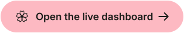

<p align="center">
  <a href="https://sarah_cleo.github.io/kyoto-sakura-causal/"></a>
</p>
<p align="center">
  <a href="https://sarah_cleo.github.io/kyoto-sakura-causal/"></a>
  &nbsp;
  <a href="src/causal_analysis.py"></a>
</p>
<p align="center"><sub>An interactive data story in D3 · causal discovery with LiNGAM, ANM, PC, FCI and CD-NOD · Python</sub></p>
---

The question
Kyoto has recorded when the mountain cherry Prunus jamasakura reaches full bloom since 812, making it one of the longest phenological records anywhere. For a thousand years the average date barely moved. Since the late 1800s it has moved from 18 April to 31 March, and 2023 brought the earliest full bloom in the record.
Which climate and weather variables cause the shift, and what is left that measured weather cannot explain?

What the analysis finds
Cause	Effect on full bloom	Evidence
March temperature	2.5 days earlier per °C	Direct edge in every method given time order. LiNGAM bootstrap probability 1.00; PC and FCI both find `T_Mar --> Bloom`.
February temperature	0.6 days earlier per °C	Direct edge in LiNGAM (bootstrap probability 0.90), PC and FCI
Previous October temperature	0.8 days later per °C	The autumn brake: warm autumns delay dormancy. Similar size (0.7–0.8) in every trend-free specification and in both halves of the record.
Global temperature	No direct effect	Acts only through Kyoto's own temperatures. Its partial correlation with bloom, given February and March, is −0.01.
Rain, sunshine, snow, wind	Little or none	No edges in the causal graph. Once temperature is known, snow, wind and sunshine add nothing, and February–March rain adds only a small delay of about 0.9 days per 100 mm.
The effects are days per °C, estimated on year-to-year differences with Newey–West errors. Differencing removes slow shared drivers such as global warming, urban growth and changes in observers, so they cannot pose as causes.

Where the eleven days come from (1881–1910 vs 1997–2026, block-bootstrap medians):
Component	Days
March warming	−8.0
February warming	−1.9
Autumn brake (Oct–Dec)	+4.1
January	+0.2
Not explained by monthly temperature	−5.1
Observed shift	−10.8
Kyoto warmed faster than the planet. February–March rose +3.1 °C between these two periods, against +1.1 °C globally. Against JMA's 15 low-urbanisation stations, about 30% of Kyoto's spring warming since 1929 is urban excess.
About five days remain unexplained once the autumn brake is counted, and about four remain with a baseline set after the 1913 station move. Candidate latent causes: night-time (urban) warming that monthly means under-represent, a nonlinear chilling response, timing within the month, and changes in the record itself.
Blind causal discovery fails on this data. Without time order, only 1 of 7 algorithms pointed the March → bloom arrow the right way: the weather variables are too close to Gaussian. Adding the free, certain fact that time runs forward made every method agree.
Simple causal models forecast a warmer future better than ML. Trained on 1881–1996 and tested on 1997–2026, a period with 8 Marches warmer than any in training, a two-variable linear model missed by 1.7 days (RMSE). Random forest (4.1) and gradient boosting (3.8) did more than twice as badly, because trees cannot extrapolate.

The data dashboard
Open the live dashboard → It is a single self-contained HTML page (`docs/index.html`), built with D3, in seven modules:
Twelve centuries of full bloom. 838 springs, one flower each, with a glowing smoothed trend.
Calendar heat map. Climate anomalies by month and decade.
Eras. Distributions of bloom dates through time.
Temperature drives blossom phenology change. The suspects, tested.
Causal graph. The consensus DAG with method-by-method sensitivity.
Attribution. A Sankey diagram of where the eleven days come from.
Methods. The pipeline, and the forecasting test.

Method
`src/causal_analysis.py` runs the whole study and writes every table to `results/`. It draws nothing.
Data. JMA monthly records with quality flags handled, and climate re-indexed to the bloom year (Oct–Dec of Y−1 → Y). Our 1929–2025 warming trends reproduce JMA's published Kyoto values month by month.
Trend removal. Year-to-year differences, so slow shared drivers cannot pose as causes.
Assumption check. Gaussianity of every variable; LiNGAM and ANM need non-Gaussian signal.
Blind discovery. DirectLiNGAM (raw and detrended), BottomUpParceLiNGAM, RCD, ANM (GP + HSIC), PC and CD-NOD.
Time-ordered discovery. DirectLiNGAM with prior knowledge and 300 bootstraps, PC (Fisher-z and KCI) and FCI with temporal tiers, and CD-NOD with a time index to test whether the bloom mechanism itself drifted. It did not.
Effects. First-differenced regressions with HAC errors, plus robustness checks: LOWESS anomalies, both halves of the record, levels with a trend, and rolling 40-year windows.
Attribution. Counterfactual decomposition with a 5-year moving-block bootstrap, post-relocation baselines, and an urban vs regional split.
Forecast test. Train 1881–1996, forecast 1997–2026: linear, ridge, random forest and gradient boosting.

Reproduce
```bash
git clone https://github.com/YOUR-USERNAME/kyoto-sakura-causal.git
cd kyoto-sakura-causal
python -m venv .venv && source .venv/bin/activate      # Windows: .venv\Scripts\activate
pip install -r requirements.txt
pip install --no-deps -r requirements-lingam.txt       # lingam's pygam pins an old SciPy; see the file
python src/causal_analysis.py                          # about a minute; --fast skips the KCI tests
```
The run is seeded and deterministic: a clean install reproduces `results/summary.json` exactly.
Output in `results/`	Contents
`summary.json`	Headline numbers from every step
`01_*`, `02_*`	Eras, Theil–Sen trends, Pettitt change points, JMA validation and urban benchmark
`03_trend_free_screen.csv`	Every candidate variable in levels and in year-to-year differences
`04_gaussianity.csv`	Shapiro–Wilk, skew and kurtosis
`05_blind_tournament.csv`	Blind causal discovery, method by method
`06_*`, `07_cdnod_edges.csv`	Time-ordered graphs, parents of bloom, and mechanism-change test
`08_*`	Effect sizes, robustness checks, other weather, rolling sensitivity
`09_*`, `10_*`	Attribution, baselines, station-move step, urban split, counterfactual series
`11_*`	Forecast test
`causal_graph.json`	Consensus graph with edge evidence

Repository
```
├── docs/                 the live dashboard (GitHub Pages)
│   └── index.html
├── src/
│   ├── clean.py          raw data → tidy, bloom-year panel
│   └── causal_analysis.py  causal discovery, effects, attribution, forecast test
├── data/
│   ├── raw/              bloom record, JMA workbook, global temperature
│   ├── processed/        rebuilt by clean.py
│   └── README.md         sources, licences, cleaning rules, column guide
├── results/              tables written by causal_analysis.py
└── assets/               banner, buttons, social preview
```

Caveats
There are about 140 years of overlapping weather and bloom data. One observatory sits about 7 km from the Arashiyama trees. Monthly means cannot separate day from night or early from late in a month. Bloom dates are whole days. JMA's urban and rural trends are cited constants, not re-estimated here. The autumn brake is the one edge the methods disagree on: LiNGAM keeps it, while PC and FCI drop it.

Data and credits
Full-bloom dates: © Yasuyuki Aono; Aono & Kazui (2008) Int. J. Climatol. 28: 905–914; Aono & Saito (2010) Int. J. Biometeorol. 54: 211–219; via the GMU peak-bloom-prediction repository (CC BY-NC-SA 4.0).
Weather: Source: Japan Meteorological Agency website, Kyoto Local Meteorological Observatory monthly values. Public Data License 1.0.
Global temperature: NOAA GCAG via `datasets/global-temp` (ODC-PDDL).
Context: Christidis, Aono & Stott (2022) Environ. Res. Lett. 17: 054051; JMA Heat Island Monitoring Report.
Design: batlow and vik colour maps (Crameri, Scientific Colour Maps); Bodoni Moda, Inter and Shippori Mincho B1 (SIL Open Font License).
Full terms are in `data/README.md`.

License
Code is released under the MIT License (see `LICENSE`). Data keep their original terms, listed above.
